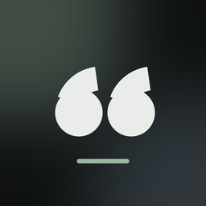
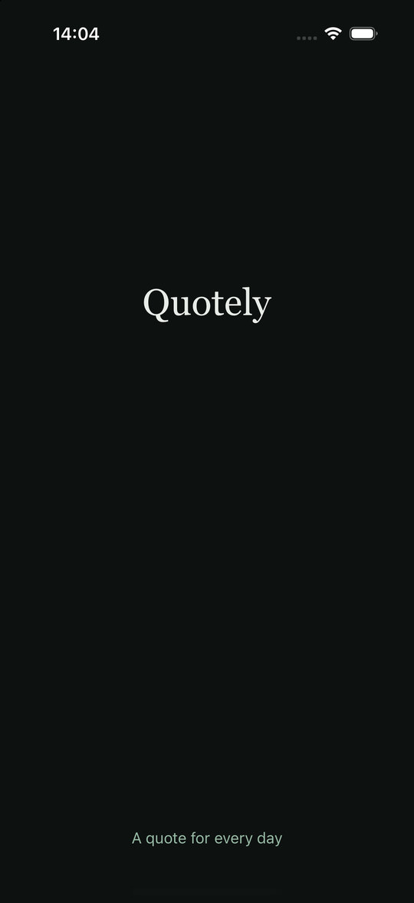
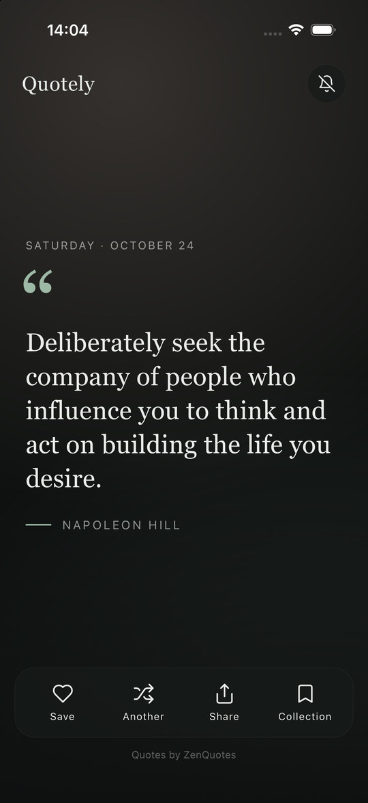
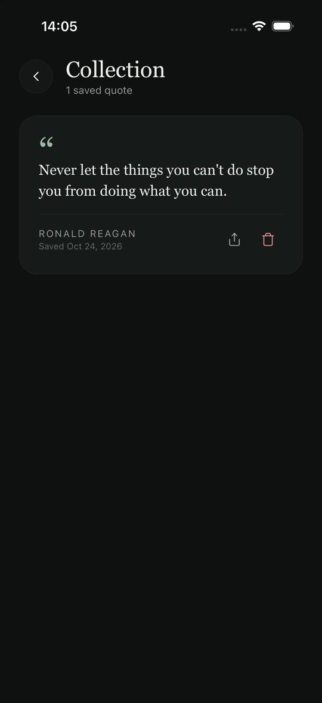

<div align="center">



# Quotely

A calm daily-quote app built with **React Native CLI** and **TypeScript**.


&nbsp;

&nbsp;


</div>

## Features

- A new quote every day, with shuffle and pull-to-refresh
- Opens instantly, with cached and offline fallback quotes
- Save favourites to a collection, share them, and undo deletes
- Optional 7:00 AM daily reminder notification
- Calm, slowly drifting gradient background that changes daily

## Tech

React Native 0.88 · TypeScript · React Navigation · AsyncStorage · react-native-notify-kit · react-native-svg · Jest

## Run it

```bash
npm install
npm run pods          # iOS only
npm run ios           # or: npm run android
```

`npm run validate` runs the type check, lint and tests.

## About

This started as my first Expo app while I was learning React Native. I later rebuilt it from scratch with the React Native CLI to learn native tooling, structure the code properly, and polish the UI.

Architecture, configuration and release notes are in **[DOCUMENTATION.md](DOCUMENTATION.md)**.

Quotes from [ZenQuotes](https://zenquotes.io) · [MIT License](LICENSE)
